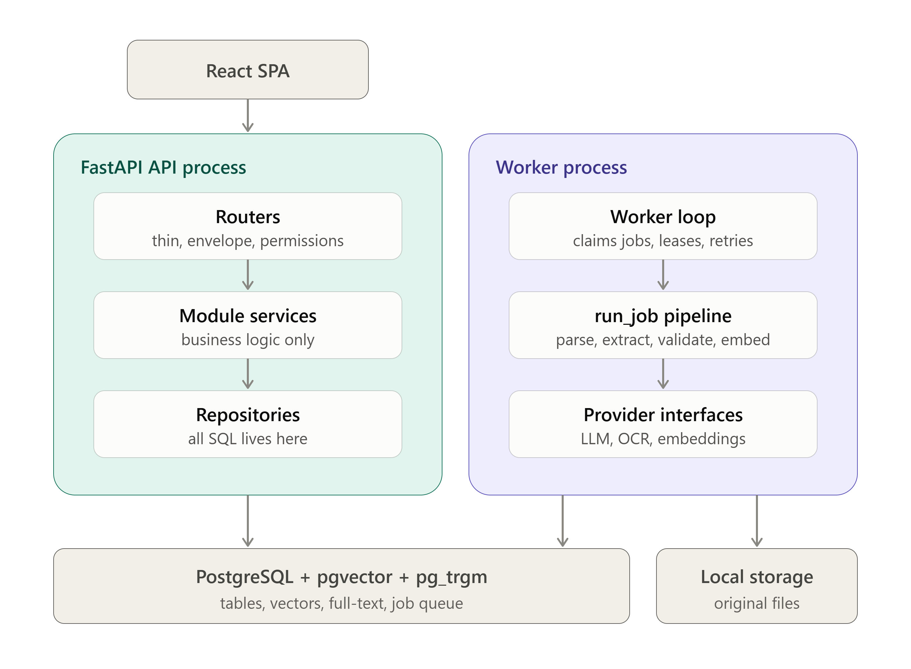
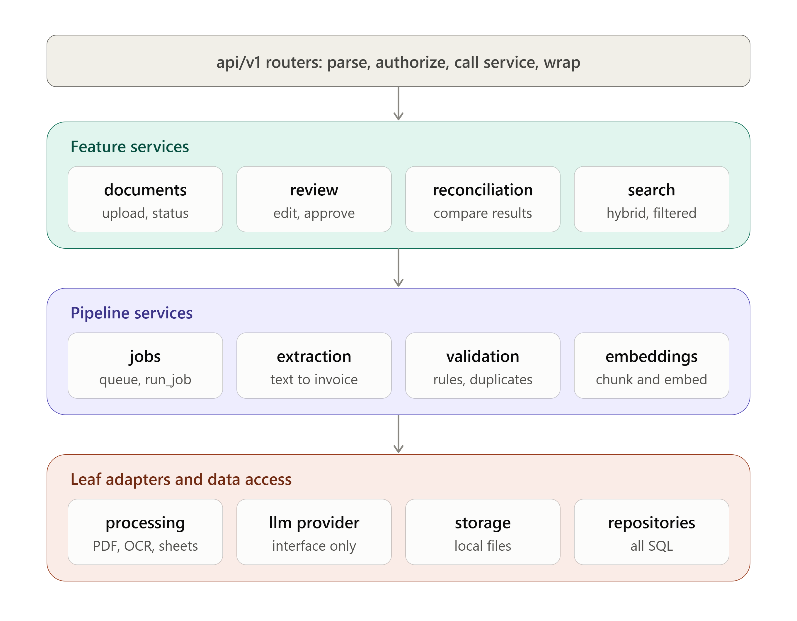
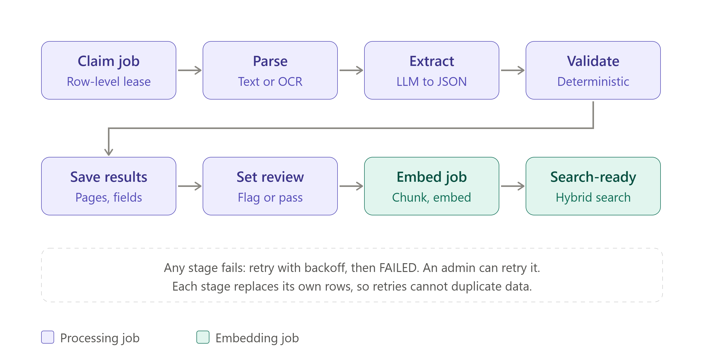

# DocuLens — Enterprise AI Document Intelligence & Financial Reconciliation Platform

[](https://www.python.org/)
[](https://fastapi.tiangolo.com/)
[](https://github.com/pgvector/pgvector)
[](https://ai.google.dev/)
[](https://react.dev/)
[](https://playwright.dev/)

**DocuLens** is a production-grade, full-stack AI Document Intelligence system engineered for financial operations, accounts payable auditing, and cross-document reconciliation. It combines **non-deterministic LLM extraction** (Google Gemini) with **strictly deterministic `Decimal` financial validation**, **human-in-the-loop (HITL) review workflows**, **cross-document PDF/Excel reconciliation**, **hybrid semantic + lexical search (Reciprocal Rank Fusion)**, and **declarative Role-Based Access Control (RBAC)**.

---

## Table of Contents

1. [Key Capabilities](#key-capabilities)
2. [System Architecture](#system-architecture)
3. [Technology Stack](#technology-stack)
4. [Repository Structure](#repository-structure)
5. [Prerequisites & Database Requirements](#prerequisites--database-requirements)
6. [Configuration & Environment Variables](#configuration--environment-variables)
7. [Quick Start & Local Setup](#quick-start--local-setup)
8. [Document Processing Pipeline](#document-processing-pipeline)
9. [Security, RBAC & User Lifecycle](#security-rbac--user-lifecycle)
10. [API Overview](#api-overview)
11. [Testing & Verification](#testing--verification)
12. [Key Architectural Decisions & Trade-Offs](#key-architectural-decisions--trade-offs)
13. [Additional Documentation](#additional-documentation)

---

## Key Capabilities

- **Multi-Format Document Ingestion**: Batch streaming uploads (`PDF`, `PNG`, `JPEG`, `XLSX`, `CSV`) with magic-byte signature verification, SHA-256 content fingerprinting, per-file size guardrails, and HTTP `201` / `207 Multi-Status` / `422` batch diagnostics.
- **Hybrid Parsing & Local OCR Fallback**: Native PDF text-layer extraction via PyMuPDF with automatic per-page rasterization (`300 DPI`) and local ONNX OCR fallback (`rapidocr-onnxruntime`) when text density falls below `PDF_MIN_TEXT_CHARS`.
- **Structured AI Invoice Extraction**: Zero-temperature (`LLM_TEMPERATURE=0`) extraction via `gemini-2.5-flash` into strict Pydantic v2 schemas (`Numeric(19,4)` monetary fields, ISO-8601 dates, normalized supplier/customer headers, and line items), preserving immutable raw LLM output in `extraction_metadata`.
- **Deterministic Financial Validation Engine**: Pure `Decimal`-based validation rules completely decoupled from LLM logic—verifying required header fields, line-item math (`quantity * unit_price == amount`), subtotal/tax/total rollups within configurable tolerance (`VALIDATION_TOLERANCE=0.01`), OCR confidence thresholds, and duplicate invoice detection.
- **Human-in-the-Loop (HITL) Review & Audit Trail**: Two-pane side-by-side document viewer and correction workspace with state machine transitions (`pending` / `needs_review` $\rightarrow$ `in_review` $\rightarrow$ `corrected` $\rightarrow$ `approved` / `rejected`), field-level diff tracking (`document_corrections`), and synchronous re-validation upon edit.
- **Cross-Document Reconciliation (`PDF-to-PDF` & `PDF-to-Excel`)**: Pure functional comparator supporting tolerance-aware monetary matching ($\max(\text{abs\_tol}, \text{pct\_tol} \times \text{expected})$), normalized corporate supplier names, and interactive worksheet column mapping with auto-suggestion.
- **Hybrid Vector + Full-Text Search (RRF)**: Combines PostgreSQL `tsvector` (`websearch_to_tsquery` + `ts_headline`), `pg_trgm` fuzzy supplier matching, and `pgvector` HNSW cosine similarity (`gemini-embedding-001`, 768 dimensions) fused via **Reciprocal Rank Fusion ($k=60$)** and rendered with XSS-safe `<mark>` tokenization.
- **Enterprise RBAC & Session Security**: 4 canonical roles (`FINANCE_EXECUTIVE`, `FINANCE_MANAGER`, `ACCOUNTS_AUDIT`, `SYSTEM_ADMIN`), 13 declarative permissions, Argon2id password hashing, refresh token rotation with replay family revocation, `token_version` immediate session invalidation, forced first-login password rotation, and SHA-256 hashed single-use invite/reset links.

---

## System Architecture

DocuLens is designed as a **modular monolith** running two runtime processes from a single backend codebase—the **FastAPI HTTP Server** (`uvicorn app.main:app`) and the **Background Worker** (`python -m app.worker`)—backed exclusively by **PostgreSQL** for relational persistence, job queueing (`FOR UPDATE SKIP LOCKED`), full-text indexing (`GIN`), and vector similarity search (`HNSW`).



### Module Layering & Strict Dependency Rules



1. **Thin Routers (`app/api/*`)**: Parse HTTP inputs, enforce `Depends(require_permission(Permission.X))`, delegate to domain services, and return standardized envelopes. Zero inline SQL or business rules.
2. **Domain Services (`app/services/*`, `app/extraction/*`, `app/validation/*`, `app/reconciliation/*`, `app/search/*`)**: Orchestrate business workflows, state transitions, and provider protocols.
3. **Repositories (`app/repositories/*`)**: Encapsulate all SQLAlchemy 2.0 queries and lock semantics (`FOR UPDATE`, `SKIP LOCKED`).
4. **Pure Domain Isolation**: `validation` and `reconciliation` never import from `extraction` or `processing`; they operate strictly on normalized, persisted database records.

---

## Technology Stack

| Layer | Technology | Version / Spec | Purpose |
| :--- | :--- | :--- | :--- |
| **Backend Framework** | FastAPI + Uvicorn | `0.162.0` / `0.54.0` | REST API (`/api/v1/*`), dependency injection, OpenAPI 3.1 schema |
| **ORM & Database Driver** | SQLAlchemy 2.0 + `psycopg` v3 | `2.1.6` / `3.3.6` | Strongly-typed ORM models, session management, connection pooling |
| **Database & Extensions** | PostgreSQL (Supabase) | PG 15+ (`vector`, `pg_trgm`) | Primary store, `SKIP LOCKED` job queue, HNSW vector search, trigram search |
| **Schema Migrations** | Alembic | `1.20.1` | Idempotent versioned DDL migrations |
| **Document Parsing & OCR** | PyMuPDF + RapidOCR + OpenPyXL | `2.0` / `1.4.4` / `3.1.5` | PDF text extraction, local ONNX OCR fallback, Excel/CSV parsing |
| **AI & Embeddings** | Google GenAI SDK (`google-genai`) | `2.34.0` | `gemini-2.5-flash` (extraction) & `gemini-embedding-001` (`768`-dim vectors) |
| **Auth & Cryptography** | PyJWT + `argon2-cffi` | `2.15.1` / `25.1.0` | Access JWTs, SHA-256 refresh/action tokens, Argon2id password hashes |
| **Frontend Framework** | React + TypeScript + Vite | `18.3` / `5.7` / `6.1` | Strict SPA with React Router v6 and code-split build chunks |
| **UI & Styling** | Tailwind CSS + Radix UI (shadcn) | `3.4` | Accessible primitives, responsive workspace shell, semantic status tokens |
| **State & Data Fetching** | TanStack Query v5 + RHF + Zod | `5.66` / `7.54` / `3.24` | Conditional polling, cache invalidation, schema-validated forms |
| **API Type Safety** | `openapi-typescript` | `7.6.1` | Automated TypeScript DTO generation from backend `openapi.json` |
| **Testing** | Pytest, Vitest, Playwright | `9.2` / `3.0` / `1.65` | Isolated DB schema tests, component unit tests, full-stack E2E tests |

---

## Repository Structure

```text
DocuLens/
├── backend/
│   ├── alembic/                  # Alembic migration environment & revision scripts
│   ├── app/
│   │   ├── ai/                   # Gemini LLM provider protocol & client adapters
│   │   ├── api/                  # FastAPI routers (auth, users, documents, jobs, reviews, reconciliation, search, audit, health)
│   │   ├── core/                 # Settings (config.py), RBAC (permissions.py), JWT/Argon2 (security.py), error handlers
│   │   ├── db/                   # SQLAlchemy DeclarativeBase & SessionLocal factory
│   │   ├── embeddings/           # Text chunker & 768-dim L2-normalized embedding service
│   │   ├── extraction/           # Prompt templates, LLM extraction orchestrator, field normalizers
│   │   ├── models/               # 14 SQLAlchemy ORM models (User, Document, ExtractedInvoice, DocumentChunk, etc.)
│   │   ├── processing/           # PDF/Image/Spreadsheet parsers & RapidOCR engine wrapper
│   │   ├── reconciliation/       # Pure PDF-to-PDF & PDF-to-Excel comparator, column auto-matcher
│   │   ├── repositories/         # Data access layer & SQL query builders
│   │   ├── schemas/              # Strict Pydantic v2 request/response DTOs
│   │   ├── search/               # Hybrid search (tsvector + pgvector RRF fusion)
│   │   ├── services/             # Domain services (auth, user lifecycle, review state machine, audit)
│   │   ├── validation/           # Deterministic Decimal financial validation rules & duplicate detector
│   │   ├── worker/               # PostgreSQL FOR UPDATE SKIP LOCKED worker loop & pipeline stages
│   │   ├── create_admin.py       # CLI utility to create or recover a SYSTEM_ADMIN account
│   │   ├── main.py               # FastAPI application entrypoint & lifespan bootstrap
│   │   └── seed.py               # Idempotent role & initial admin seeding logic
│   ├── scripts/                  # Smoke test scripts (smoke_day2.py, smoke.bat)
│   ├── tests/                    # Backend pytest suite (runs in isolated TEST_SCHEMA)
│   ├── .env.example              # Backend environment variable template
│   ├── alembic.ini               # Alembic configuration
│   └── requirements.txt          # Pinned Python dependencies
├── frontend/
│   ├── e2e/                      # Playwright full-stack E2E test suites & global setup
│   ├── src/
│   │   ├── components/           # AppLayout, Sidebar, TopBar, and shadcn/Radix UI primitives
│   │   ├── features/             # Domain modules: auth, documents, review, reconciliation, search, audit, users
│   │   ├── hooks/                # Custom React hooks (usePermissions, debounce, etc.)
│   │   ├── lib/                  # Unified API client, generated OpenAPI types, RBAC matrix, formatters
│   │   ├── App.tsx               # Route tree & provider hierarchy
│   │   └── main.tsx              # React DOM entry point
│   ├── .env.example              # Frontend environment variable template
│   ├── openapi.json              # Backend OpenAPI specification snapshot
│   ├── package.json              # Frontend dependencies & npm scripts
│   ├── playwright.config.ts      # Dual-server Playwright configuration
│   └── vite.config.ts            # Vite bundler & /api proxy configuration
├── docs/
│   ├── ARCHITECTURE.md           # Modular monolith boundaries & design specification
│   ├── DAY3_NOTES.md             # Backend endpoint catalog, review state machine, RRF & reconciliation specs
│   ├── FRONTEND_DAY3_NOTES.md    # Frontend route architecture, XSS-safe snippets, money string safety
│   ├── DECISIONS.md              # Architectural Decision Records (ADRs)
│   ├── ERD.md                    # Complete 14-table Mermaid Entity-Relationship Diagram & index catalog
│   ├── TEST_CASES.md             # Comprehensive test case matrix
│   └── rbac-audit.md             # Security & RBAC enforcement audit
├── TestFiles/                    # Sample PDF, scanned image, and invoice test fixtures
└── README.md                     # Project documentation (this file)
```

---

## Prerequisites & Database Requirements

### System Prerequisites
- **Python**: `3.12+` (with `venv`)
- **Node.js**: `20+` and `npm`
- **PostgreSQL**: `15+` (Local PostgreSQL or **Supabase**) with `vector` (`pgvector`) and `pg_trgm` extensions available.
- **Google Gemini API Key**: Required for live AI invoice extraction and semantic embeddings (test suites use deterministic fake providers and do not require an API key).

### Important Supabase / PostgreSQL Configuration Notes
1. **Use the Supabase SESSION Pooler (`port 5432`)** with the `postgresql+psycopg://` scheme in `backend/.env`:
   - **Do NOT** use the direct database host (`db.<project>.supabase.co`), which is IPv6-only on Supabase's free tier and unreachable from standard IPv4 networks.
   - **Do NOT** use the transaction pooler on `port 6543`, which is incompatible with session-scoped features such as `SET search_path`.
2. **PostgreSQL Extensions**:
   - `vector` and `pg_trgm` must be enabled in the `extensions` schema:
     ```sql
     CREATE SCHEMA IF NOT EXISTS extensions;
     CREATE EXTENSION IF NOT EXISTS vector WITH SCHEMA extensions;
     CREATE EXTENSION IF NOT EXISTS pg_trgm WITH SCHEMA extensions;
     ```
   - The initial Alembic migration runs these statements idempotently.

---

## Configuration & Environment Variables

### 1. Backend Environment (`backend/.env`)

Create `backend/.env` from `backend/.env.example`:

| Variable | Required | Default | Description |
| :--- | :---: | :--- | :--- |
| **`DATABASE_URL`** | **Yes** | — | PostgreSQL connection URL using `postgresql+psycopg://` (Port `5432` Session Pooler for Supabase). |
| **`JWT_SECRET`** | **Yes** | — | High-entropy secret key (min 32 bytes recommended) for signing HS256 access tokens. |
| **`ADMIN_EMAIL`** | **Yes** | — | Bootstrap email for the initial `SYSTEM_ADMIN` account seeded when zero admins exist. |
| **`ADMIN_PASSWORD`** | **Yes** | — | Bootstrap password for the initial `SYSTEM_ADMIN` account (flagged with `must_change_password=True`). |
| `ADMIN_NAME` | No | `Admin` | Display name for the initial bootstrap administrator. |
| `TEST_SCHEMA` | No | `doculens_test` | Isolated PostgreSQL schema created/dropped during `pytest` runs (never touches `public`). |
| `JWT_EXPIRE_MINUTES` | No | `60` | Access JWT lifetime in minutes. |
| `REFRESH_TOKEN_EXPIRE_DAYS` | No | `7` | Rotating refresh token lifetime in days (`1`–`90`). |
| `INVITE_TTL_HOURS` | No | `72` | Time-to-live in hours (`1`–`720`) for single-use user invite and password reset links. |
| `FRONTEND_BASE_URL` | No | `http://localhost:5173` | Frontend origin used when constructing one-time invite and password reset URLs. |
| `CORS_ORIGINS` | No | `http://localhost:5173` | Comma-separated list of allowed CORS origins. |
| `STORAGE_DIR` | No | `backend/storage` | Local filesystem directory where uploaded files are streamed. |
| `MAX_UPLOAD_MB` | No | `25` | Maximum permitted size per uploaded file in megabytes. |
| `WORKER_POLL_SECONDS` | No | `2.0` | Polling interval (seconds) for the PostgreSQL background worker loop. |
| `JOB_STALE_MINUTES` | No | `10` | Minutes after which a locked `PROCESSING` job is considered stale and recovered. |
| `PDF_MIN_TEXT_CHARS` | No | `50` | Minimum extracted characters per PDF page before triggering local OCR fallback. |
| `OCR_DPI` | No | `300` | Rasterization DPI when converting low-text PDF pages for OCR. |
| `OCR_LOW_CONFIDENCE_THRESHOLD` | No | `0.75` | Average OCR confidence (`0.0`–`1.0`) below which a `LOW_OCR_CONFIDENCE` validation issue is emitted. |
| `MAX_PREVIEW_ROWS` | No | `100` | Maximum rows stored per spreadsheet worksheet during table parsing. |
| **`GEMINI_API_KEY`** | **Yes*** | `""` | Google Gemini API key (*required when `LLM_PROVIDER=gemini` or `EMBEDDING_PROVIDER=gemini`). |
| `LLM_PROVIDER` | No | `gemini` | Extraction LLM backend (`gemini` for production, `fake` for offline/testing). |
| `LLM_MODEL` | No | `gemini-2.5-flash` | Explicit pinned Gemini model ID (aliases ending in `-latest` are rejected at startup). |
| `LLM_TEMPERATURE` | No | `0.0` | Sampling temperature (`0.0` for deterministic structured extraction). |
| `LLM_MAX_INPUT_CHARS` | No | `60000` | Maximum character budget sent to the LLM per extraction request. |
| `EMBEDDING_PROVIDER` | No | `gemini` | Vector embedding backend (`gemini` or `fake`). |
| `EMBEDDING_MODEL` | No | `gemini-embedding-001` | Pinned embedding model ID. |
| `EMBEDDING_DIM` | No | `768` | Vector dimensionality (verified at startup against the migration's `vector(768)` column). |
| `EMBEDDING_BATCH_SIZE` | No | `32` | Batch size (`1`–`100`) for chunk embedding API calls. |
| `VALIDATION_TOLERANCE` | No | `0.01` | Monetary math tolerance (`Decimal`) for invoice subtotal/tax/total validation. |
| `RECONCILIATION_AMOUNT_TOLERANCE_ABSOLUTE` | No | `0.05` | Absolute monetary tolerance (`Decimal`) during cross-document reconciliation. |
| `RECONCILIATION_AMOUNT_TOLERANCE_PERCENTAGE` | No | `0.001` | Percentage monetary tolerance (`0.001` = `0.1%`) during reconciliation. |
| `RECONCILIATION_DATE_TOLERANCE_DAYS` | No | `0` | Allowed calendar day difference when reconciling invoice dates. |
| `SEARCH_DEFAULT_LIMIT` | No | `20` | Default page size for `/api/v1/search`. |
| `SEARCH_MAX_LIMIT` | No | `100` | Maximum page size for `/api/v1/search`. |
| `SEARCH_MIN_SEMANTIC_SCORE` | No | `0.6` | Minimum cosine similarity threshold (`0.0`–`1.0`) for semantic vector matches. |
| `SEARCH_RRF_K` | No | `60` | Smoothing constant $k$ for Reciprocal Rank Fusion ($RRF(d) = \sum \frac{1}{k + \text{rank}(d)}$). |

### 2. Frontend Environment (`frontend/.env`)

Create `frontend/.env` from `frontend/.env.example`:

| Variable | Default | Scope | Description |
| :--- | :--- | :--- | :--- |
| `VITE_API_BASE_URL` | `/api` | Browser (`import.meta.env`) | Base URL prefix for API calls. Keep `/api` in local dev to route through Vite's proxy without CORS preflights. |
| `BACKEND_URL` | `http://127.0.0.1:8000` | Vite Dev Server Only | Target FastAPI server URL for the `/api` proxy in `vite.config.ts`. Never bundled into browser code. |

---

## Quick Start & Local Setup

Running DocuLens locally requires **three terminal sessions**: the **FastAPI Server**, the **Background Worker**, and the **Vite Frontend Dev Server**.

### Step 1 — Backend API Setup (Terminal 1)

```cmd
cd backend

:: 1. Create or activate the virtual environment
python -m venv venv
venv\Scripts\activate

:: 2. Install pinned dependencies
python -m pip install -r requirements.txt

:: 3. Configure environment variables
copy .env.example .env
:: -> Edit backend\.env with your DATABASE_URL, JWT_SECRET, ADMIN_EMAIL, ADMIN_PASSWORD, and GEMINI_API_KEY

:: 4. Apply Alembic database migrations
alembic upgrade head

:: 5. Start the FastAPI server (auto-seeds canonical roles & initial SYSTEM_ADMIN on boot)
uvicorn app.main:app --reload --host 127.0.0.1 --port 8000
```

- **Interactive Swagger UI**: `http://127.0.0.1:8000/docs`
- **Health Check Endpoint**: `http://127.0.0.1:8000/api/v1/health`

### Step 2 — Background Worker Setup (Terminal 2)

The background worker polls PostgreSQL (`processing_jobs`) using `FOR UPDATE SKIP LOCKED` to execute document parsing, OCR, Gemini LLM extraction, deterministic validation, and vector chunk embedding asynchronously:

```cmd
cd backend
venv\Scripts\activate

:: Run the continuous worker loop
python -m app.worker

:: Or process a single queued job and exit:
python -m app.worker --once
```

### Step 3 — Frontend Setup (Terminal 3)

```cmd
cd frontend

:: 1. Configure environment variables
copy .env.example .env

:: 2. Install Node.js dependencies
npm install

:: 3. Start the Vite development server
npm run dev
```

- **Web Application**: `http://localhost:5173`
- Sign in with the `ADMIN_EMAIL` and `ADMIN_PASSWORD` configured in `backend/.env`. On first login, the bootstrap admin is prompted to rotate their password before accessing protected workspaces.

---

## Document Processing Pipeline



Each uploaded document enqueues a `DOCUMENT_PROCESSING` job in `processing_jobs` within the same database transaction as the document record. Every pipeline stage is **idempotent** (deletes its own prior output for that document before inserting fresh rows) and updates `processing_jobs.locked_at` as a heartbeat:

1. **Stage 1 — Parse & OCR (`app/processing`)**:
   - **PDFs**: Extracts native text per page via PyMuPDF. Pages with fewer than `PDF_MIN_TEXT_CHARS` (`50`) characters are rasterized at `OCR_DPI` (`300`) and passed through `RapidOCR`.
   - **Images (`PNG`/`JPEG`)**: Processed directly through `RapidOCR` with per-page confidence scoring.
   - **Spreadsheets (`XLSX`/`CSV`)**: Parsed into structured sheet/column/row JSONB tables (`document_parse_results.tables`) for PDF-to-Excel reconciliation.
2. **Stage 2 — Structured LLM Extraction (`app/extraction`)**:
   - Sends page text to `gemini-2.5-flash` using versioned prompts and strict JSON schema output.
   - Normalizes dates, currency codes, supplier names, and `Decimal` amounts into `extracted_invoices` and `invoice_line_items`.
   - Saves the untouched raw LLM response in `extracted_invoices.extraction_metadata["raw_llm_output"]`.
3. **Stage 3 — Deterministic Financial Validation (`app/validation`)**:
   - Evaluates required fields, numeric non-negativity, line-item arithmetic (`qty * unit_price == amount`), header rollup (`subtotal + tax == total` within `VALIDATION_TOLERANCE`), low OCR confidence, and cross-document duplicate detection.
   - Routes documents with `ERROR` issues or low confidence to `review_status = needs_review`; clean documents enter `pending`.
4. **Stage 4 — Chunking & Vector Embedding (`app/embeddings`)**:
   - Splits extracted page text into overlapping semantic chunks, computes `tsvector` full-text indexes, and generates L2-normalized `768`-dimensional embeddings via `gemini-embedding-001` stored in `document_chunks`.

---

## Security, RBAC & User Lifecycle

### Declarative Role-Based Access Control Matrix

All backend routes enforce permissions via `Depends(require_permission(Permission.<NAME>))` backed by `backend/app/core/permissions.py` (mirrored in `frontend/src/lib/permissions.ts` for UI rendering hints):

| Permission Code | Capability | `FINANCE_EXECUTIVE` | `FINANCE_MANAGER` | `ACCOUNTS_AUDIT` | `SYSTEM_ADMIN` |
| :--- | :--- | :---: | :---: | :---: | :---: |
| `document:upload` | Upload documents | Allowed | Allowed | — | Allowed |
| `document:view` | View & download documents | Allowed | Allowed | Allowed | Allowed |
| `extraction:view` | View extracted invoice fields | Allowed | Allowed | Allowed | Allowed |
| `validation:view` | View validation issues | Allowed | Allowed | Allowed | Allowed |
| `extraction:edit` | Edit invoice header fields in review | Allowed | Allowed | — | Allowed |
| `correction:approve` | Approve or reject reviewed invoices | — | Allowed | — | Allowed |
| `reconciliation:run` | Execute PDF-PDF / PDF-Excel reconciliation | Allowed | Allowed | Allowed | Allowed |
| `reconciliation:view` | View reconciliation reports | Allowed | Allowed | Allowed | Allowed |
| `search:use` | Execute hybrid/semantic/keyword search | Allowed | Allowed | Allowed | Allowed |
| `audit:view` | View system-wide & document audit trails | — | Allowed | Allowed | Allowed |
| `user:manage` | Create, invite, edit roles, deactivate users | — | — | — | Allowed |
| `job:view` | Inspect background processing jobs | — | — | — | Allowed |
| `job:retry` | Retry failed jobs / reprocess documents | — | — | — | Allowed |

### Admin Recovery CLI (`app.create_admin`)

Because startup bootstrap only seeds `ADMIN_EMAIL` when **zero** `SYSTEM_ADMIN` users exist in the database, operators can create or recover an administrator account at any time (resetting password, reactivating, and bumping `token_version`) via CLI:

```cmd
cd backend
venv\Scripts\activate

:: Interactive prompt (recommended so passwords are not saved in shell history)
python -m app.create_admin

:: Or via flags
python -m app.create_admin --email admin@example.com --password "YourStrongPassword123!" --full-name "System Admin"
```

---

## API Overview

All endpoints are canonically mounted under `/api/v1/*` (with backward-compatible aliases at `/api/*`). Full interactive documentation is available at `http://127.0.0.1:8000/docs`.

| Domain | Endpoints | Summary |
| :--- | :--- | :--- |
| **Health** | `GET /api/v1/health` | Service liveness, PostgreSQL connectivity, and storage directory check. |
| **Auth** | `POST /auth/login`, `/auth/refresh`, `/auth/logout`, `/auth/change-password`, `/auth/accept-invite`, `GET /auth/me` | JWT issuance, refresh token rotation, forced password rotation, and invite acceptance. |
| **Users & Admin** | `GET/POST /users`, `PATCH /users/{id}`, `/users/{id}/role`, `/users/{id}/status`, `POST /admin/users/{id}/reset-password` | User lifecycle management, single-use invite/reset link generation, and last-admin protection. |
| **Documents** | `POST /documents/upload`, `GET /documents`, `/documents/{id}`, `/documents/{id}/file`, `/documents/{id}/extraction`, `/documents/{id}/validation`, `/documents/{id}/history`, `POST /documents/{id}/reprocess` | Multi-file ingestion, raw file streaming, extraction/validation inspection, and reprocessing. |
| **Human Review** | `GET /reviews`, `GET /reviews/{id}`, `PATCH /reviews/{id}/corrections`, `POST /reviews/{id}/approve`, `POST /reviews/{id}/reject` | Review queue filtering, header field corrections with immutable diff logging, and manager sign-off. |
| **Reconciliation** | `GET /reconciliations/excel/{id}/sheets`, `POST /reconciliations/pdf-pdf`, `POST /reconciliations/pdf-excel`, `GET /reconciliations`, `GET /reconciliations/{id}` | Cross-document PDF-to-PDF and PDF-to-Excel comparison with interactive column mapping. |
| **Search** | `GET /api/v1/search` | Hybrid (`tsvector` + `pgvector` RRF), keyword, and semantic search with structured filters. |
| **Jobs & Audit** | `GET /jobs`, `POST /jobs/{id}/retry`, `GET /audit-logs` | Background job monitoring, manual retry, and immutable system-wide audit logs. |

---

## Testing & Verification

### 1. Backend Test Suite (`pytest`)
Backend tests run inside an isolated PostgreSQL schema (`TEST_SCHEMA=doculens_test`) with `search_path` restricted to `"doculens_test", extensions` and deterministic fake AI/OCR providers (zero external network calls):

```cmd
cd backend
venv\Scripts\activate
pytest -v
```

### 2. Frontend Unit Tests, Typecheck & Lint (`Vitest` + `TSC` + `ESLint`)

```cmd
cd frontend

:: Run Vitest unit tests (RBAC matrix, XSS snippet sanitizer, money string safety, column auto-suggest)
npm test

:: Run strict TypeScript compiler checks
npm run typecheck

:: Run ESLint with zero-warnings enforcement
npm run lint

:: Verify production bundle build
npm run build
```

### 3. Full-Stack End-to-End Tests (`Playwright`)
Playwright automatically boots (or reuses) both the FastAPI backend (`127.0.0.1:8000`) and Vite frontend (`127.0.0.1:5173`), seeds dedicated E2E test users via `e2e/global-setup.ts`, and verifies authentication, RBAC navigation guards, and end-to-end workflows:

```cmd
cd frontend

:: Run headless Chromium E2E suite
npm run test:e2e

:: Run interactive Playwright UI mode
npm run test:e2e:ui
```

### 4. Regenerating Frontend OpenAPI Types
Whenever backend Pydantic schemas or route signatures change, synchronize the frontend TypeScript definitions:

```cmd
cd frontend
npm run gen:api
```

---

## Key Architectural Decisions & Trade-Offs

- **PostgreSQL Job Queue (`FOR UPDATE SKIP LOCKED`) vs. Redis/Celery**: Enqueuing jobs in the same PostgreSQL transaction as document creation guarantees zero lost jobs without a dual-write distributed transaction or external broker infrastructure.
- **Immediate Session Revocation (`token_version`) vs. Stateless JWTs**: Every access JWT embeds `"tv": user.token_version`, verified against PostgreSQL on each authenticated request. This trades one primary-key lookup per request for immediate token invalidation upon user deactivation, role demotion, or password reset.
- **Single-Use SHA-256 Hashed Action Tokens (`user_action_tokens`)**: User invites and admin-initiated password resets generate a 32-byte CSPRNG token (`secrets.token_urlsafe(32)`), persist only its SHA-256 hash with a 72-hour TTL, and return the one-time link for clipboard sharing—eliminating external SMTP dependencies while preventing token exposure if database rows are leaked.
- **Last-Admin & Self-Action Concurrency Guardrails (`SELECT ... FOR UPDATE`)**: Role demotions and account deactivations acquire row-level locks on active `SYSTEM_ADMIN` records within the transaction and reject self-demotion, self-deactivation, or removing the final active administrator (`409 Conflict`).
- **End-to-End `Decimal` & String Money Handling**: Monetary values are stored as `NUMERIC(19,4)` in PostgreSQL, validated with Python's `Decimal` module on the backend, and manipulated as strings in the React frontend—completely eliminating IEEE-754 floating-point rounding errors.
- **XSS-Proof Search Snippet Tokenization**: Search highlights generated by PostgreSQL `ts_headline` (`<mark>...</mark>`) are parsed by a pure React tokenizer (`frontend/src/features/search/snippet.tsx`) without `dangerouslySetInnerHTML`, neutralizing any HTML/script payloads embedded in untrusted OCR text.

---

## Additional Documentation

For deep-dive specifications, diagrams, and operational notes, inspect the [`docs/`](docs/) directory:

- **[`docs/ARCHITECTURE.md`](docs/ARCHITECTURE.md)** — Modular monolith layout, dependency boundaries, job queue semantics, and search pipeline design.
- **[`docs/ERD.md`](docs/ERD.md)** — Complete 14-table Mermaid Entity-Relationship Diagram, column specifications, and B-Tree / GIN / HNSW index catalog.
- **[`docs/DECISIONS.md`](docs/DECISIONS.md)** — Detailed Architectural Decision Records (ADRs) and explicit engineering trade-offs.
- **[`docs/DAY3_NOTES.md`](docs/DAY3_NOTES.md)** — Complete REST endpoint catalog, human review state machine, pure reconciliation comparator tolerances, and Reciprocal Rank Fusion formulas.
- **[`docs/FRONTEND_DAY3_NOTES.md`](docs/FRONTEND_DAY3_NOTES.md)** — Frontend route table, RBAC UI gating architecture, XSS snippet sanitization, and verification logs.
- **[`docs/TEST_CASES.md`](docs/TEST_CASES.md)** — End-to-end functional, security, and edge-case test specifications.
- **[`docs/rbac-audit.md`](docs/rbac-audit.md)** — Route-by-route RBAC permission enforcement audit.
