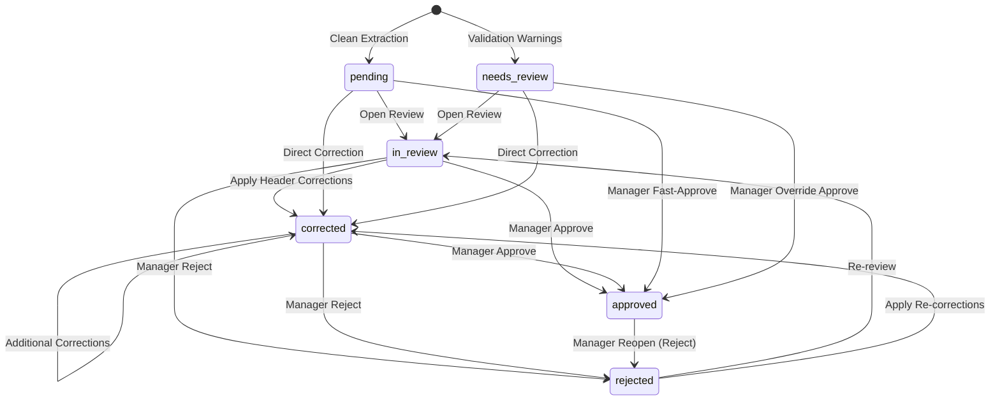

# DocuLens Day 3 — Backend Architectural & Operational Notes

## 1. Complete Endpoint Directory (Day 1 – Day 3)

All endpoints are canonically mounted under `/api/v1/*`. Day 1–2 routers maintain backward-compatible non-schema aliases under `/api/*` to guarantee zero breakage for legacy clients.

| HTTP Method | Canonical Route (`/api/v1/*`) | Legacy Alias (`/api/*`) | Permitted Roles | Required Permission | Description |
|---|---|---|---|---|---|
| `GET` | `/health` | `/health` | *Public / Any* | None | Service liveness, DB connection, storage health |
| `POST` | `/auth/login` | `/auth/login` | *Public* | None | Authenticate with email/password; returns access JWT & refresh token |
| `POST` | `/auth/refresh` | `/auth/refresh` | *Public* | None | Rotate refresh token and issue new access JWT |
| `POST` | `/auth/logout` | `/auth/logout` | All Active Roles | None | Revoke refresh token family and session |
| `GET` | `/auth/me` | `/auth/me` | All Active Roles | None | Current authenticated user profile and permissions |
| `GET` | `/users` | `/users` | `SYSTEM_ADMIN` | `user:manage` | List users (paginated, role/status filtered) |
| `POST` | `/users` | `/users` | `SYSTEM_ADMIN` | `user:manage` | Create new user with assigned role |
| `GET` | `/users/{id}` | `/users/{id}` | `SYSTEM_ADMIN` | `user:manage` | Get user details |
| `PATCH` | `/users/{id}` | `/users/{id}` | `SYSTEM_ADMIN` | `user:manage` | Update user profile (name, email) |
| `PATCH` | `/users/{id}/role` | `/users/{id}/role` | `SYSTEM_ADMIN` | `user:manage` | Change user role (self-demote & last-admin protected) |
| `PATCH` | `/users/{id}/status` | `/users/{id}/status` | `SYSTEM_ADMIN` | `user:manage` | Deactivate/activate user (self-deactivate protected) |
| `POST` | `/documents/upload` | `/documents/upload` | `EXEC`, `MGR`, `ADMIN` | `document:upload` | Multipart file upload (PDF, XLSX, CSV, PNG, TIFF) |
| `GET` | `/documents` | `/documents` | All Active Roles | `document:view` | List accessible documents (visibility-filtered) |
| `GET` | `/documents/{id}` | `/documents/{id}` | All Active Roles | `document:view` | Document detail & metadata |
| `GET` | `/documents/{id}/file` | `/documents/{id}/file` | All Active Roles | `document:view` | Stream raw stored file bytes |
| `GET` | `/documents/{id}/status` | `/documents/{id}/status` | All Active Roles | `document:view` | Processing & review status summary |
| `GET` | `/documents/{id}/extraction`| `/documents/{id}/extraction`| All Active Roles | `extraction:view` | Structured extraction result & line items |
| `GET` | `/documents/{id}/validation`| `/documents/{id}/validation`| All Active Roles | `validation:view` | Deterministic financial validation results |
| `GET` | `/documents/{id}/history` | `/documents/{id}/history` | All Active Roles | `audit:view` | Unified document timeline (uploads, stages, reviews) |
| `POST`| `/documents/{id}/reprocess`| `/documents/{id}/reprocess`| `EXEC`, `MGR`, `ADMIN` | `job:retry` | Trigger reprocessing for a document |
| `GET` | `/reviews` | `/reviews` | All Active Roles | `extraction:view` | Filterable human review queue |
| `GET` | `/reviews/{id}` | `/reviews/{id}` | All Active Roles | `extraction:view` | Human review detail (meta, current, original, issues) |
| `PATCH`| `/reviews/{id}/corrections`| `/reviews/{id}/corrections`| `EXEC`, `MGR`, `ADMIN` | `extraction:edit` | Apply header corrections (blocked if APPROVED) |
| `POST` | `/reviews/{id}/approve` | `/reviews/{id}/approve` | `MGR`, `ADMIN` | `correction:approve` | Approve reviewed document (moves to `approved`) |
| `POST` | `/reviews/{id}/reject` | `/reviews/{id}/reject` | `MGR`, `ADMIN` | `correction:approve` | Reject reviewed document (reopens from `approved`) |
| `GET` | `/audit-logs` | `/audit-logs` | `MGR`, `AUDIT`, `ADMIN` | `audit:view` (global) | Global system audit trail (paginated, filtered) |
| `GET` | `/jobs` | `/jobs` | All Active Roles | `job:view` | List background processing jobs |
| `GET` | `/jobs/{id}` | `/jobs/{id}` | All Active Roles | `job:view` | Detail of a background processing job |
| `POST` | `/jobs/{id}/retry` | `/jobs/{id}/retry` | `EXEC`, `MGR`, `ADMIN` | `job:retry` | Re-queue failed background job |
| `GET` | `/reconciliations/excel/{id}/sheets` | `/reconciliations/...` | All Active Roles | `reconciliation:view` | Discover worksheet table names in parsed workbook |
| `POST` | `/reconciliations/pdf-pdf` | `/reconciliations/pdf-pdf` | All Active Roles | `reconciliation:run` | Deterministic PDF-to-PDF invoice reconciliation |
| `POST` | `/reconciliations/pdf-excel` | `/reconciliations/pdf-excel`| All Active Roles | `reconciliation:run` | Deterministic PDF-to-Excel worksheet reconciliation |
| `GET` | `/reconciliations` | `/reconciliations` | All Active Roles | `reconciliation:view` | List reconciliation jobs (status/type filtered) |
| `GET` | `/reconciliations/{id}` | `/reconciliations/{id}` | All Active Roles | `reconciliation:view` | Detailed comparison results with tolerances |
| `GET` | `/search` | `/search` | All Active Roles | `search:use` | Hybrid search (tsvector + pgvector RRF fusion) |

---

## 2. Review and Correction State Machine

### Review Status Values & Valid Transitions
- **`pending`**: Initial state after automated processing if all validation checks passed cleanly.
- **`needs_review`**: Automated processing completed with validation warnings or errors.
- **`in_review`**: Reviewer has inspected the document detail.
- **`corrected`**: Header field corrections applied by `FINANCE_EXECUTIVE`, `FINANCE_MANAGER`, or `SYSTEM_ADMIN`.
- **`approved`**: Approved by `FINANCE_MANAGER` or `SYSTEM_ADMIN`. Locked against further edits.
- **`rejected`**: Rejected by `FINANCE_MANAGER` or `SYSTEM_ADMIN` (reopens document for further correction).

### Correction Invariants
1. **Immediate Header Mutation**: Corrections are applied directly to `extracted_invoices` current values.
2. **Audit Preservation**: For every modified field, an immutable `document_corrections` row is persisted with `original_value` (the value before this change), `corrected_value`, `corrected_by`, and optional `correction_reason`.
3. **Immutability of Original LLM Payload**: `extracted_invoices.extraction_metadata["raw_llm_output"]` is NEVER overwritten.
4. **Header-Only Editing**: Allowed fields strictly restricted to: `invoice_number`, `invoice_date`, `supplier_name`, `customer_name`, `subtotal`, `tax`, `total`, `currency`. Line-item editing is explicitly out of scope per PRD specifications.
5. **Approved Lock Guard**: Editing an `approved` document returns `409 Conflict`. Re-editing requires a Finance Manager to reject/reopen first.

---

## 3. Reconciliation Architecture (Pure Comparator)

### Comparison Philosophy & Decoupling
The reconciliation engine (`app/reconciliation/comparator.py`) is written as a pure, zero-I/O functional comparator. It accepts strongly-typed normalized Python structures and returns comparison status, discrepancies, and metadata without database side effects.

### Preconditions
- **PDF-to-PDF**: Both documents must have `status == 'parsed'` and an existing `extracted_invoices` record.
- **PDF-to-Excel**: The source PDF must have `status == 'parsed'` and an `extracted_invoices` record. The target Excel document must have `status == 'parsed'` and non-empty `document_parse_results.tables`.

### Tolerances & Matching Rules
- **Amount Matching**:
  - `RECONCILIATION_AMOUNT_TOLERANCE_ABSOLUTE` = `0.05` ($0.05)
  - `RECONCILIATION_AMOUNT_TOLERANCE_PERCENTAGE` = `0.001` (0.1%)
  - Formula: Difference $\le \max(\text{abs\_tol}, \text{pct\_tol} \times \text{expected})$.
- **Date Matching**:
  - `RECONCILIATION_DATE_TOLERANCE_DAYS` = `0` (exact calendar date match).
- **Supplier Name Normalization**:
  - Normalized by stripping punctuation, lowercasing, and removing common corporate suffixes (`ltd`, `inc`, `corp`, `llc`, `plc`, `gmbh`, `sa`, `limited`).
- **Invoice Number Normalization**:
  - Alphanumeric stripping of non-alphanumeric separators (`INV-2026/001` matches `INV2026001`).
- **Discrepancy Statuses**:
  - `MATCH`: Values align within configured tolerances.
  - `MISMATCH`: Values differ beyond allowed tolerance.
  - `MISSING_SOURCE`: Value absent in source document.
  - `MISSING_TARGET`: Value absent in target document.

---

## 4. Search Architecture (Hybrid RRF Fusion)

### Query Pipeline
1. **Pre-filtering Subquery**:
   - Evaluates `visible_documents_filter(user)` (single source of visibility truth).
   - Evaluates structured metadata filters: `supplier_name` (ILIKE/trigram), `date_from`, `date_to`, `amount_min`, `amount_max`, `review_status`.
   - Filters candidate document IDs in SQL before ranking.
2. **Keyword Ranking**:
   - `websearch_to_tsquery('english', query)` against `document_chunks.content_tsv`.
   - Generates headline snippet with `ts_headline` using `<mark>` highlighting.
   - Structured header boost for exact matches in `supplier_name`, `customer_name`, or `invoice_number`.
3. **Semantic Ranking**:
   - Embeds query string via configured `EmbeddingProvider` (producing normalized 768-dim vector).
   - Measures pgvector cosine distance: `similarity = 1.0 - (embedding <=> query_vec)`.
   - Filters candidate chunks by `min_score` (default `0.6`).
4. **Reciprocal Rank Fusion (RRF)**:
   - Fuses ranked lists with $RRF(d) = \sum_{m} \frac{1}{k + rank_m(d)}$ with default $k = 60$.
   - Determines `match_type`: `KEYWORD`, `SEMANTIC`, or `BOTH`.
   - Paginates over the fused result set and hydrates document and invoice summaries.

---

## 5. Deviations Between PRD v1.1 and Repository Implementation

| Dimension | PRD v1.1 Specification | Repository Implementation | Rationale / Reconciled Behavior |
|---|---|---|---|
| **Parsed Text Storage** | `document_pages` and `spreadsheet_sheets` tables with `page_id` FK on chunks | `document_parse_results` (JSONB) with `document_chunks.page_number` (`INTEGER NULL`) | Preserves Day 1–2 zero-regression persistence; avoids complex multi-table joins while maintaining identical query capabilities. |
| **API URL Mounts** | `/api/v1/*` | Canonical `/api/v1/*` + legacy `/api/*` aliases | Guarantees compliance with PRD Section 6 while preventing breaking changes for Day 1–2 test suites and frontend callers. |
| **Status String Casing** | UPPERCASE status strings (`PENDING`, `COMPLETED`, `RUNNING`) | Lowercase DB constraints (`uploaded`, `processing`, `parsed`, `failed`, `pending`, `needs_review`, `in_review`, `corrected`, `approved`, `rejected`) | Preserves existing DB CHECK constraints while supporting case-insensitive query parameter filters across all review and search APIs. |
| **PDF-to-Excel Target** | Expects `extracted_invoices` on both documents | Inspects `document_parse_results.tables` on Excel documents | Allows raw spreadsheet ledgers and multi-sheet workbooks without synthetic single-invoice extraction to reconcile directly against PDF invoices. |
| **Line-Item Human Review** | Vague mention in review screen | Explicitly scoped to invoice headers only (`invoice_number`, `date`, `supplier`, `customer`, `subtotal`, `tax`, `total`, `currency`) | Line-item editing is explicitly designated out of scope for Day 3 backend; simplifies audit trail and prevents state corruption. |
| **Visibility Rule MVP** | Organization-scoping | `visible_documents_filter(user)` returns `sa.true()` | Single-visibility-rule architecture (PRD assumption #11) strictly enforced everywhere; tightening to tenant/uploader scoping requires modifying only one function. |

