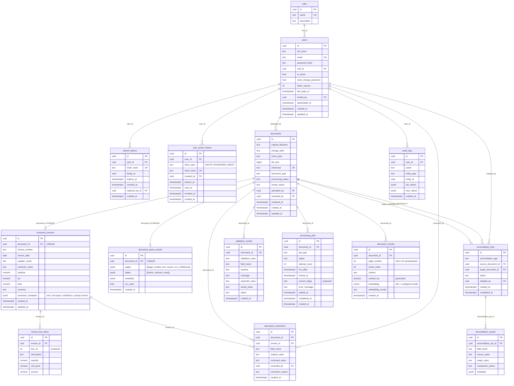

# DocuLens — ERD

Based on PRD section 5.10 (14 tables). Render with any Mermaid viewer (GitHub, VS Code Mermaid extension, mermaid.live).

## Column types

- All PKs `uuid` (default `gen_random_uuid()`).
- Money: `NUMERIC(19,4)`. Quantity: `NUMERIC(18,6)`. Never float.
- `invoice_date`: `date`. All timestamps: `timestamptz`.
- Status/type columns: `text` + CHECK constraint (easier to migrate than native PG enums).
- `reconciliation_jobs.source_document_id` / `target_document_id`: `ON DELETE RESTRICT` so reconciliation history survives (PRD principle 7).
- `audit_logs`: no FK cascade; append-only.
- `document_chunks.embedding`: `vector(N)`; N fixed by the pinned model. Table is created on Day 2 after the model is chosen.
- `reconciliation_results.source_value/target_value`: text, because they hold amounts, dates and strings.

## Indexes (PRD 5.10 principle 13)

| Table | Index |
|---|---|
| `document_chunks` | HNSW on `embedding` (`vector_cosine_ops`); GIN on `content_tsv`; B-tree on `document_id`; UNIQUE `(document_id, chunk_index)` |
| `extracted_invoices` | B-tree `invoice_number`, `invoice_date`, `total`; B-tree `lower(supplier_name)`; GIN `supplier_name gin_trgm_ops` |
| `documents` | `processing_status`, `review_status`, `uploaded_by`, `created_at`; UNIQUE `checksum` |
| `processing_jobs` | partial `(status, run_after)` WHERE status = 'PENDING'; **partial UNIQUE `(document_id, job_type)` WHERE status IN ('PENDING','PROCESSING')** |
| `validation_results` | `(document_id)`, `(validation_code)` |
| `document_parse_results` | UNIQUE `(document_id)` |
| `invoice_line_items` | `(invoice_id)` |
| `reconciliation_jobs` | `(source_document_id)`, `(target_document_id)`, `(status)` |
| `audit_logs` | `(entity_type, entity_id)`, `(user_id, created_at)`, `(action)`, `(created_at)` |
| `refresh_tokens` | UNIQUE `(token_hash)`, `(user_id)`, `(family_id)` |
| `users` | UNIQUE `(email)`, `(role_id)` |

## Additions & Deviations from PRD (small, each justified)

| Item | Why |
|---|---|
| `document_parse_results` + `document_chunks.page_number` (replaces `document_pages`, `spreadsheet_sheets`, `page_id`) | Day 1 stores parsed pages and spreadsheet tables as JSONB in a single `document_parse_results` row per document; `document_chunks` tracks `page_number` (`INTEGER NULL`) directly instead of a `page_id` FK. |
| `refresh_tokens` | Supports `POST /api/v1/auth/refresh` and `/logout` with SHA-256 hashed refresh tokens, token rotation (`replaced_by_id`), and family-based replay detection (`family_id`). |
| `documents.reviewed_by`, `reviewed_at` | PRD requires "approving user" in the audit; a column is cheaper to query than digging through `audit_logs`. Approval event still also goes to `audit_logs`. |
| `processing_jobs.current_stage` | Worker updates `locked_at` per stage; showing the stage in "processing history" costs one column. |
| `invoice_line_items.line_no` | Stable ordering of line items. |

Drop any of these if you want a strict PRD match.

## Things to watch

- Search filter `reconciliation_status` has no column on `documents`. Derive it with an `EXISTS` over `reconciliation_jobs` (source or target = document). Do not denormalize.
- `extracted_invoices` holds current (corrected) values. The original values live in `extraction_metadata` and `document_corrections`. Never overwrite without writing a correction row.
- Duplicate detection key: normalized supplier + invoice_number + invoice_date + total (exact). Index the first two for speed.
